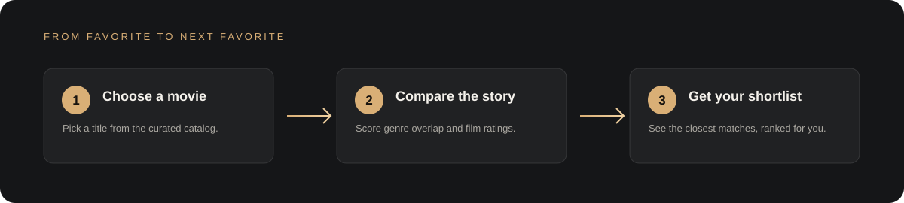
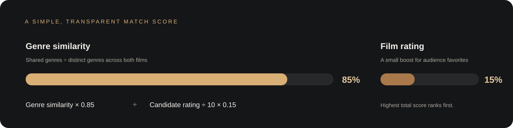

# Movie Match

A small, polished movie discovery website backed by a Java 17 recommendation engine. Choose a film you already enjoy and get a ranked shortlist of titles with similar genres and strong audience ratings. The app runs locally, with no database or external API key required.



## What it does

- Serves a responsive dark cinema-inspired website from the Java application.
- Lists the built-in movie collection and lets you pick a title or click a catalog card.
- Ranks up to six recommendations, excluding the selected title.
- Searches and filters the collection by genre, and saves favorites in the browser.
- Loads a Wikipedia summary and thumbnail on demand for each catalog film, with a direct source link.
- Offers clear loading, validation, and error feedback in the website.
- Keeps a command-line mode available with `--cli`.

## How recommendations work

The recommender compares the selected movie's genres with every other movie. It measures genre similarity with Jaccard similarity (shared genres divided by the total distinct genres across both films), then blends that with the candidate's rating on a 10-point scale:

```text
match score = 0.85 × genre similarity + 0.15 × (candidate rating ÷ 10)
```

Candidates with the highest score appear first; title order breaks ties. This is a content-based recommender: it does not learn from personal viewing history. Ratings and titles come from the sample catalog in `MovieRecommendationService`.



## Run locally

Requirements: Java 17 or newer and Maven.

From the project root, run:

```bash
cd java
mvn compile
mvn exec:java -Dexec.mainClass=com.example.movierecommendation.App
```

Open [http://localhost:8080](http://localhost:8080). Set the `PORT` environment variable to use another port.

To run the original interactive console experience instead:

```bash
mvn exec:java -Dexec.mainClass=com.example.movierecommendation.App -Dexec.args="--cli"
```

## API

The website uses two small JSON endpoints served by the same application:

| Endpoint | Description |
| --- | --- |
| `GET /api/movies` | Returns the available movie titles, genres, and ratings. |
| `GET /api/recommend?title=Inception&limit=6` | Returns ranked recommendations for a catalog title. `limit` is capped at 12. |

Unknown titles and blank searches return an HTTP 400 response with a JSON `error` message.

## Wikipedia film details

Opening **About this film** loads the English Wikipedia page summary and thumbnail for that title using Wikimedia's page-summary REST endpoint. The source article is linked beside the summary; data is requested only when a visitor opens a film and is cached for the current page session. If the API cannot be reached, the detail panel offers a direct article link. [Wikimedia REST API documentation](https://www.mediawiki.org/wiki/Wikimedia_REST_API/en)

Wikipedia text and images may have different reuse terms. The app links back to the source article; check the linked page and image's license before redistributing material outside this app.

## Project structure

```text
src/main/java/com/example/movierecommendation/  Java model, recommendation service, and web server
src/main/resources/web/                        Website HTML, CSS, and browser JavaScript
src/test/java/                                 Existing JUnit tests for recommendation behavior
docs/images/                                   README diagrams (SVG)
```

## Customization

Add or edit catalog entries in `MovieRecommendationService`. The browser interface is in `src/main/resources/web`; the `App` class serves those assets and provides the JSON API. The sample catalog is deliberately small, so adding more curated movies is the quickest way to broaden recommendations.

## License

No license has been specified for this project.
